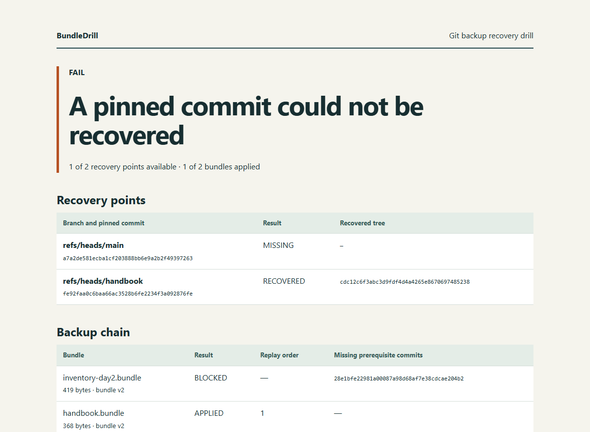

# BundleDrill

If the Git server disappeared tonight, which branch tips could you restore from your backups? BundleDrill answers that question by rebuilding a bare repository from local Git bundles and looking for the exact commits you asked it to recover. The original repository is not needed for the drill.

A nightly incremental bundle can have the right checksum and still be useless on its own. In the warehouse example below, the retention job kept Tuesday’s inventory update but dropped Monday’s base. The handbook has an independent backup, so it still comes back.



## Try it on a small backup

Download the [CLI distribution and warehouse example](https://github.com/Almeida96/bundledrill/releases/tag/v0.1.0). The CLI needs Java 21 and Git on your PATH (use a modern Git with SHA-256 repository support). On Windows use `bin\bundledrill.bat` wherever the examples use `bin/bundledrill`. Or unzip the warehouse example and open `broken/report.html` directly; viewing that file needs neither tool.

```sh
bin/bundledrill demo --out warehouse
bin/bundledrill drill --plan warehouse/complete.json --out restored --keep-repo
git --git-dir=restored/recovered.git show main:inventory.csv
```

The last command reads an actual restored blob:

```csv
sku,stock
bolts,8
```

| Demo plan | What the drill proves | Verdict |
| --- | --- | --- |
| `broken.json` | The inventory incremental is blocked by a missing commit. The separate handbook branch restores. | FAIL |
| `complete.json` | Both branches restore. The incremental is listed first but applied after its base. | PASS |
| `degraded.json` | Only the handbook is required. It restores, but the inventory incremental remains blocked. | DEGRADED |

Every run writes a self-contained HTML report and a machine-readable `report.json`. Output directories must be new. Use `--keep-repo` only when you want a copy of the restored Git objects.

## Drill your own backups

First record the expected branch tips while the source repository is available. Use existing backup bundles, or start with a full one:

```sh
git -C /srv/inventory bundle create /backups/inventory/full.bundle refs/heads/main
bin/bundledrill plan --repo /srv/inventory --branch main \
  --bundle /backups/inventory/full.bundle --out /backups/inventory/plan.json
```

Repeat `--branch` for each required branch and `--bundle` for each retained archive. Capture the plan for the backup point you actually intend to restore. A branch that moved after the backup can legitimately fail that drill. Keep a trusted copy of the plan outside the source server; checksums detect changes relative to that copy, not the authenticity of the plan itself.

Copy the plan and bundles to your recovery machine, preserving relative paths. Run:

```sh
bin/bundledrill drill --plan /backups/inventory/plan.json --out drill-001 --strict
```

The plan records the Git object format, one SHA-256 file digest per archive, and one full commit ID per branch. You can pin a historical commit instead of a branch tip by editing its ID in the plan. All branch refs use the full `refs/heads/…` form.

| Exit | Meaning |
| --- | --- |
| 0 | All requested commits recovered. Without `--strict`, this includes DEGRADED. |
| 1 | A required commit is missing, or strict mode found an unapplied or absent archive. Read the report. |
| 2 | Invalid plan, checksum mismatch, corrupt applicable pack, failed integrity check, or execution error. Do not treat this run as recovery evidence. |

## What gets checked

1. Copy each available bundle to scratch storage while computing its SHA-256. A named file that has disappeared is recorded as `ABSENT`.
2. Start with an empty bare repository. Check prerequisite commit IDs against the objects already recovered. For each eligible archive, run Git’s own `bundle verify` and `bundle unbundle`, then anchor its advertised tips under private refs so later increments can depend on them.
3. Retry blocked archives after progress. When no more can be applied, record the prerequisite IDs still missing. For each pinned commit, restore its branch ref and record its tree ID if available.
4. Run `git fsck --full --strict` on the resulting repository. A clean fsck means the imported objects are intact; the requested commits can **still be missing**.

The drill never checks out project files or fetches missing objects. It covers local Git bundle v2/v3 files and SHA-1/SHA-256 repositories. It does not restore LFS payloads, submodule repositories, issues, pull requests, hooks, working tree changes, or hosting settings. A blocked pack has had its file digest checked, but its objects have not been imported or verified. Use trusted archives; Git pack expansion can consume more disk space than the compressed inputs. Limits: 64 bundles, 128 recovery points, 1 GiB per input, 4 GiB total, 8,192 header entries across inputs. Filtered bundles are rejected.

## Inspect a result from an agent

Start a stdio MCP server bound to **one finished report**. The agent can ask which branches are missing and which prerequisite blocks a particular archive. It cannot select a different file, execute Git, or change backups.

```json
{
  "mcpServers": {
    "bundledrill": {
      "command": "java",
      "args": ["-cp", "/opt/bundledrill/lib/*", "io.github.almeida96.bundledrill.MainKt",
               "mcp", "--report", "/reports/drill-001/report.json"]
    }
  }
}
```

| Tool | Use it to |
| --- | --- |
| `restore_summary` | Read the verdict, object format, fsck result and recovered/applied counts. |
| `list_restore_points` | Page through branch refs, pinned commits and tree IDs; filter by `MISSING` or `RECOVERED`. |
| `list_bundles` | Identify an archive by index, name, checksum, replay order or state. |
| `bundle_prerequisites` | Give a bundle index to inspect prerequisite commits and which are missing. |

For the bundled example, ask: *“Can I recover main and handbook? For any blocked bundle, give me the missing commit ID and tell me what to restore first.”* Report files contain branch names, archive names and object IDs. Share them with the same care as your backup inventory.

## Build and verify

```sh
./gradlew test installDist distZip
build/install/bundledrill/bin/bundledrill demo --out build/warehouse
python checks/native_restore.py --install-dir build/install/bundledrill --demo build/warehouse
```

The integration tests use real Git processes, including a SHA-256 round trip and a damaged pack whose recorded checksum matches the damaged bytes. The independent check compares the recovered commits, trees and file contents to a plain Git clone and fetch. CI also queries all four tools with the official Python MCP client on Linux and Windows.

Implementation: Kotlin/JVM for planning, bundle parsing and restore orchestration; Java for the stdio MCP server. Git supplies the object database, pack reader and integrity checks. See the [Git bundle manual](https://git-scm.com/docs/git-bundle) and [bundle header format](https://git-scm.com/docs/gitformat-bundle) for the underlying archive contract.

[MIT license](LICENSE)
